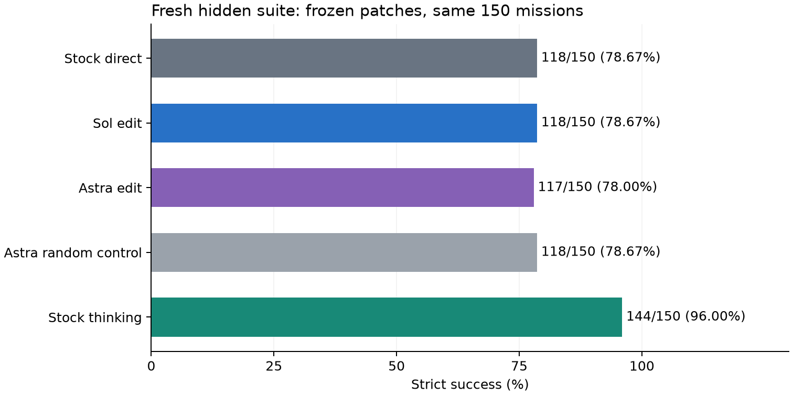
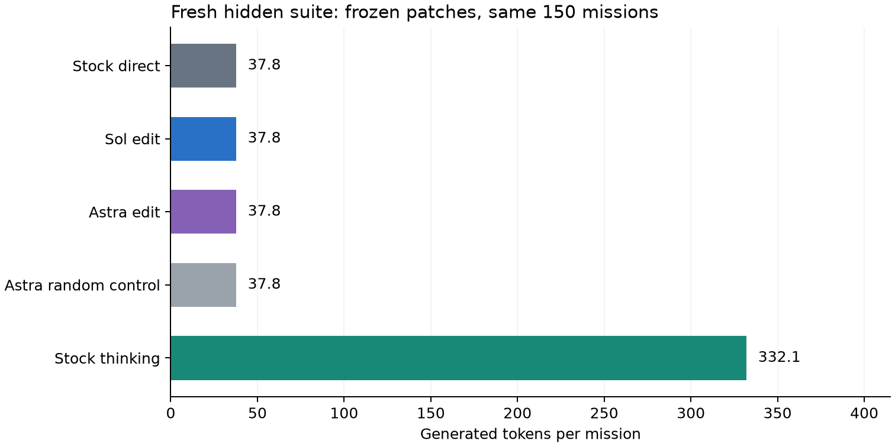

# LFM3 weight-space repair

Can an LLM repair a small model by editing a few stored weights? We tested two
bounded attempts on corrected mission orders in Liquid LFM3-1.7B.

The first Sol edit repaired one additional case on its original final suite.
That was a small result. We then froze an Astra edit and compared both patches
on a fresh hidden suite generated after Astra stopped editing.

[](https://github.com/Mr-Neutr0n/lfm3-weight-space-repair/actions/workflows/verify.yml)

[Illustrated HF write-up](https://huggingface.co/spaces/hxrikp/lfm3-weight-space-repair)
· [Kaggle notebook](https://www.kaggle.com/code/uranium53/lfm3-weight-space-repair)
· [Method and limits](docs/method.md)
· [CPU replay](replay.py)

## Fresh hidden evaluation

On the fresh hidden suite, stock direct passed 118/150, the Astra edit passed 117/150, and stock thinking passed 144/150. The Astra patch did not improve strict accuracy on this fresh suite.

| Configuration | Strict success | Output tokens | Gains / regressions vs stock direct |
| --- | ---: | ---: | ---: |
| Stock direct | 118/150 | 5,669 | reference |
| Sol edit, direct | 118/150 | 5,669 | 0 / 0 |
| Astra edit, direct | 117/150 | 5,668 | 0 / 1 |
| Astra random control | 118/150 | 5,669 | 0 / 0 |
| Stock thinking | 144/150 | 49,820 | 27 / 1 |



These are fixed model configurations on the same 150 synthetic missions, with
75 unchanged/updated pairs. The private cases were created only after both
patches were frozen. This is one task grammar and seed, not a general agent
benchmark or a universal ranking of editor models.



Output tokens measure response length. Zeroing columns does not shrink the dense
model or reduce its matrix dimensions. Serial arm order prevents a controlled
latency comparison. The stronger stock thinking configuration remains visible.

Astra changed two fresh-suite outputs: one revoked action became a safe hold with the wrong reason, while a previously correct hold acquired a wrong reason. Actual revoked actions fell from five to four; safe-hold contract failures rose from three to five. Strict scoring stayed frozen. Sol changed one output without a graded gain. The Astra random control matched stock outputs exactly.

## What was edited

Each selected patch changes exactly 16,384 BF16 values, 0.0009477% of the model.
Sol zeros eight columns in layer 23. Astra zeros four columns in layer 22 and
four in layer 23. No gradient descent, optimizer, parameter fitting, or training
was used. The LLM chose interventions using task failures and approximate
activation projections. It did not read all 1.73 billion weights as prompt text.

Both attempts had 32 adaptive target-model probe episodes and a 7,200-second
allocated-GPU cap. Sol's localization correction consumed the slot originally
planned for a half-scaling candidate. Astra tested half-scaling and zeroing,
then froze zeroing under its preset tie-break, despite no net practice-score gain.
All candidate outcomes and amendments are retained. Each attempt used one random
column control with matching layer/count/factor; this is a limited control set.

## Recompute the published evidence

```sh
git clone https://github.com/Mr-Neutr0n/lfm3-weight-space-repair.git
cd lfm3-weight-space-repair
./verify
```

Python 3.12 or later is enough. No API key, model download, or GPU is needed.
The command rescales no weights. It rescans the released BF16 bytes, semantically
rescores all public practice/development responses, and recomputes final tables
and paired gains from anonymized graded outcome rows.

Private final inputs, seeds and full final responses are withheld. Therefore the
public release supports statistic replay for final suites, not independent
semantic rescoring of those suites. Exact local evidence remains preserved;
its hashes are in `provenance/`. This limit is intentional and explicit.

## Optional fresh GPU replication

```sh
python3 -m venv .venv
source .venv/bin/activate
pip install --extra-index-url https://download.pytorch.org/whl/cu130 -r requirements-gpu.txt
python3 run_gpu.py --confirm-inference --arm all --output results/local-replication
```

This runs new inference on the public development cases by default. It downloads
the exact pinned checkpoint, checks all recorded model-file hashes, uses its
native tool template, applies each fixed patch, and restores stock weights
between arms. Use `--cases PATH` for separately generated cases. It does not
recreate the withheld final suites or repeat the editor's selection process.

## Original Sol evaluation

Development was 37/50 stock versus 38/50 edited. The original final suite was
120/150 stock versus 121/150 edited, with 120/150 for the random control and
148/150 for stock thinking. The selected patch had no regressions there. One
additional final pass is not a statistically convincing broad improvement.
This original suite and the fresh comparison are reported separately.

## Limits and evidence

Both editors localized from a small practice set and one stale numerical failure.
Astra reused the repaired tooling and prior development evidence, deliberately
excluded Sol's columns, and used high reasoning versus Sol's xhigh. This is not
a controlled test of model identity alone. Approximate activation projection
does not prove a neural mechanism for instruction authority. Preserving unchanged
missions does not establish preservation of general language capabilities.

Strict scoring requires the exact `mission_revoked` hold reason. A safe hold
with different wording remains a contract failure, and is reported separately
from actually acting after revocation. Syntax, copying, stale values, semantic
actions, reasoning completion and truncation are distinct diagnostics. Cases
are discrete tool decisions, with no physical flight simulation or production
spacecraft claim. The local process boundary was not a hard OS sandbox.

- `data/`: public cases, public raw responses, anonymized graded outcome rows.
- `results/summary.json`: replayable measurements and exploratory paired tests.
- `patches/`: exact patch specifications, receipts and reversible BF16 columns.
- `experiments/`: frozen plans, decisions and scientific worker sources.
- `provenance/`: target hashes, identities, budgets and private-evidence hashes.
- `notebooks/`: the narrative CPU replay notebook.

## Credit and license

Built and run by [Hari](https://github.com/Mr-Neutr0n), with GPT-6.1 Sol and
GPT-6 Astra as the recorded editing agents. Inspired by
[Sparks of Weight-Space Programming](https://rikiyat.github.io/blog/weight-space-programming/).
The target is [Liquid AI's LFM3-1.7B](https://huggingface.co/LiquidAI/LFM3-1.7B).
Original study code, documentation and synthetic public data use [MIT](LICENSE).
Extracted weight bytes remain under the [LFM Open License v1.0](LICENSES/LFM-1.0.txt).
See [modification notices](NOTICE.md). No complete model checkpoint is distributed.
